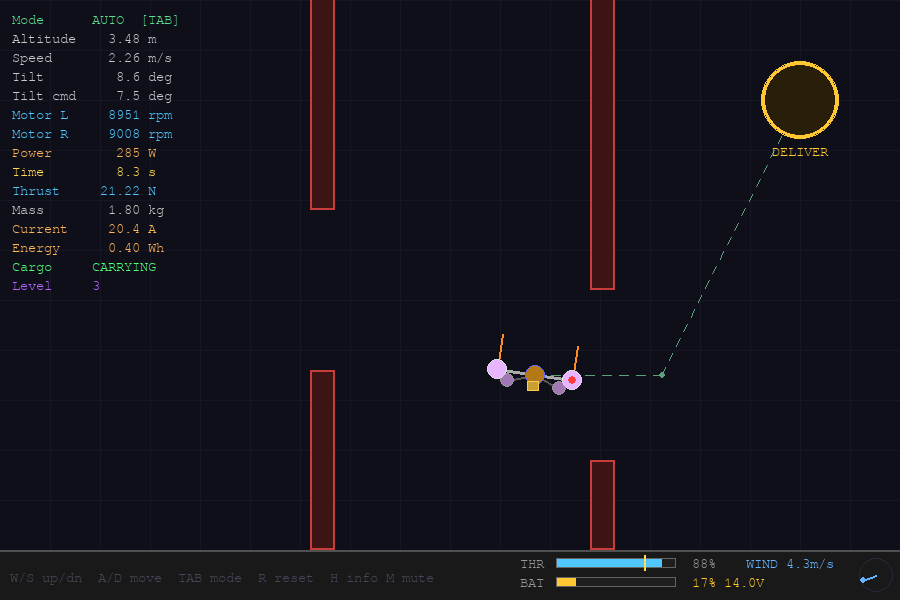
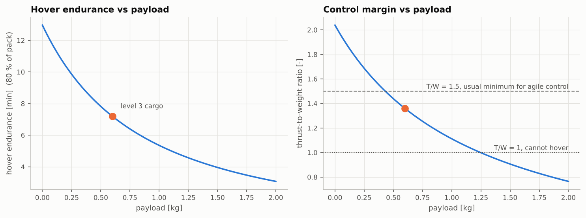
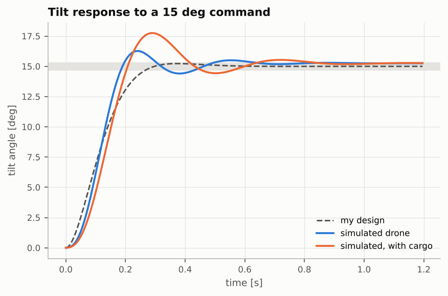

# UAV Flight Simulator

A 2D drone simulator built on real physics, with a flight controller I tuned myself and a game on top.

It started as a pygame game where the drone moved in pixels per frame and every number was whatever felt right. I wanted it to answer real questions, like how much cargo it can carry or why drones lose control on a nearly empty battery, so I rebuilt it with real units and real physics.

**Play it in the browser:** [omerburhan.com/uav-flight-sim](https://omerburhan.com/uav-flight-sim/)



## What's inside

- **Real physics:** a 1.2 kg quadrotor with real rotor thrust, motors that take time to spin up, and wind that acts through the air instead of pushing the drone directly.
- **Battery:** the voltage drops when the motors pull hard, and less voltage means less thrust.
- **Cargo:** level 3 adds a 0.6 kg box that makes the drone heavier and harder to rotate.
- **Flight controller** with four modes:
  - **Assist:** the keys set your speed, and when you let go the drone stops and holds its position.
  - **Angle:** the keys set the tilt and throttle, and the drone levels itself when you let go.
  - **Rate:** nothing levels it for you, which is how racing pilots fly.
  - **Auto:** the drone flies the course on its own.
- **Three levels:** checkpoints, gates in a gusty crosswind, and a cargo delivery on a nearly empty battery.
- **Flight logs and graphs** for every finished level.

## What I found out

Adding 0.6 kg of cargo almost halves hover time (13.0 to 7.2 minutes) and leaves much less spare thrust. As the battery empties, the maximum thrust drops too, so a loaded drone near empty can barely climb. These two results decided how level 3 works.



Tuning the controller was the part I spent the most time on. The simulated drone overshoots more than my design predicted because real motors take time to respond, and with cargo it bounces even more.



## Running it

Python 3.10 or newer.

```
pip install -r requirements.txt
python main.py                          # fly
python -m analysis.flight_report        # graphs for your logged flights
python -m analysis.flight_report --demo # let the autopilot fly, then graph it
python -m pytest                        # run the checks
python dashboard.py                     # browse your flights at http://127.0.0.1:5000
```

Controls: W/S or arrow keys to move, hold Shift for slow precise moves, TAB flight mode, R reset, H more info, M mute. The yellow arrow next to the drone points to the next target.

## Project layout

```
uavsim/       simulation (physics, battery, wind, controller, levels)
main.py       the game
analysis/     flight reports and graphs
dashboard.py  local viewer for your flights
docs/         browser version and project page
tests/        checks
```

## What I'd add next

- Hang the cargo on a rope, so the controller has to stop it from swinging.
- Make it fully 3D.
- Add sensor noise, since a real drone never knows its exact tilt.

## License

MIT, Ömer Burhan Çınar
